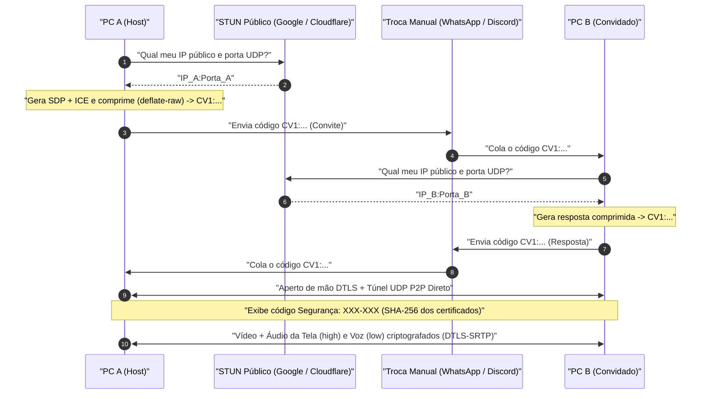
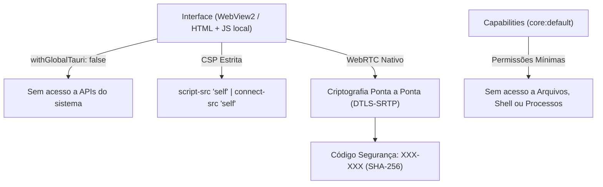

# PeerBuddy

Aplicativo desktop leve (Tauri v2) para **transmissão de tela e voz 100% P2P (direto de PC para PC)**, sem servidores centrais, sem conta e com isolamento estrito.

> **Foco:** Máxima qualidade na transmissão de tela (imagem e áudio da tela com prioridade `high`) e voz em segundo plano (`low`), mantendo baixo consumo de memória e privacidade total.

---

## Como funciona na prática (Passo a Passo)



---

## 1. De onde vem o código `CV1:...`?
O código que você copia e cola **não vem de nenhum servidor nosso** — ele é gerado localmente no seu próprio computador:
1. O WebRTC cria uma descrição da sessão (**SDP**), contendo os codecs suportados (Opus, H.264/VP9/AV1) e a impressão digital pública do certificado **DTLS** temporário daquela chamada.
2. O app consulta rapidamente servidores **STUN públicos** (`stun.l.google.com:19302` e `stun.cloudflare.com:3478`), que apenas respondem qual é o seu IP público e porta UDP.
3. Tudo isso é empacotado em JSON e comprimido localmente com `deflate-raw` + Base64url, gerando o código compacto `CV1:...`.
4. **Uso único:** cada código vale apenas para aquela sessão; ao desconectar, é descartado.

---

## 2. Como os PCs se conectam (e por que é P2P)
- Assim que os dois lados trocam o Convite e a Resposta, os dois computadores abrem um **túnel UDP direto** entre si (*NAT Hole Punching* via ICE).
- **O servidor STUN sai de cena:** depois de descobrir o IP:porta, nenhum áudio, vídeo ou dado passa por Google, Cloudflare ou qualquer outro servidor *(a menos que você preencha manualmente um servidor TURN nas opções avançadas)*.
- Depois de conectado, iniciar ou parar o **Compartilhamento de Tela** usa um `RTCDataChannel` interno já criptografado — sem precisar gerar novos códigos.

---

## 3. Segurança e Isolamento do Aplicativo



- **Criptografia obrigatória (DTLS-SRTP):** todo pacote de áudio, vídeo e sinalização de tela trafega criptografado ponta a ponta entre os dois PCs.
- **Verificação contra interceptação (`Segurança: XXX-XXX`):** ao conectar, ambos os PCs calculam um código curto (SHA-256 das impressões digitais DTLS dos dois lados). Se o código exibido na sua tela for igual ao do seu amigo, é garantia matemática de que não há ninguém no meio da conexão.
- **Isolamento no Windows (Tauri v2):**
  - `withGlobalTauri: false` (o JavaScript não tem acesso à ponte interna do Rust).
  - **CSP estrita:** bloqueia scripts externos, `eval` e requisições HTTP arbitrárias.
  - **Permissões mínimas (`core:default`):** o app não tem permissão para ler/gravar arquivos do seu disco, abrir terminal/shell ou listar processos.

---

## 4. Como os dados são transmitidos (Qualidade e Prioridade)
- **Prioridade Máxima (`high`):** Vídeo da tela (`H.264` por hardware com fallback automático, `VP9` ou `AV1`, até 60 fps) + Áudio da tela (**estéreo puro, até 192 kbps**, sem filtros de voz).
- **Menor Prioridade (`low`):** Voz do microfone (Opus mono limitado a **32 kbps**, pacotes de 20 ms com FEC). Se a rede oscilar, a voz cede banda antes de prejudicar a transmissão da tela.
- **Canais separados:** o volume da tela e o volume da voz têm controles independentes.

---

## 5. O que acontece ao desconectar ou fechar o app?
Ao clicar em **Desconectar** ou fechar a janela:
1. Todos os fluxos de captura (`microfone` e `tela`) são encerrados imediatamente (`track.stop()`).
2. A conexão `RTCPeerConnection` e o `DataChannel` são fechados e destruídos da memória.
3. Os códigos de convite/resposta e chaves temporárias **somem da memória** (nada é salvo em disco, não há histórico, logs nem serviço rodando em segundo plano).

---

## Downloads (GitHub Releases)
Na aba **Releases** deste repositório estão disponíveis os 3 formatos compilados diretamente a partir deste código:
1. **`peerbuddy.exe`** — Executável único portátil (basta abrir, não instala nada).
2. **`PeerBuddy_0.1.4_x64-setup.exe`** — Instalador tradicional do Windows (NSIS).
3. **`PeerBuddy_0.1.4_x64_en-US.msi`** — Instalador MSI.

*(Nota sobre o Windows SmartScreen: como o binário não possui certificado comercial pago, na primeira execução o Windows pode exibir "Mais informações -> Executar assim mesmo". Todo o código-fonte está aberto aqui para auditoria).*

---

## Qualidade, Auditoria e Pre-commit
- **CI (`.github/workflows/ci.yml`):** valida automaticamente em cada `push`/`PR` a sintaxe JS, auditoria de pacotes (`npm audit` e `cargo audit`), formatação (`cargo fmt`), análise estática (`cargo clippy`) e as regras de isolamento (`withGlobalTauri: false`, CSP estrita e `core:default`).
- **Pre-commit (`.pre-commit-config.yaml`):** executa checagens locais antes de cada commit (`pre-commit install`).

---

## Compilar por conta própria
Pré-requisitos: Node.js, Rust (`rustup`) e Microsoft C++ Build Tools.

```powershell
npm install
npm run dev    # testar em desenvolvimento
npm run build  # gerar .exe e instaladores em src-tauri/target/release/
```
